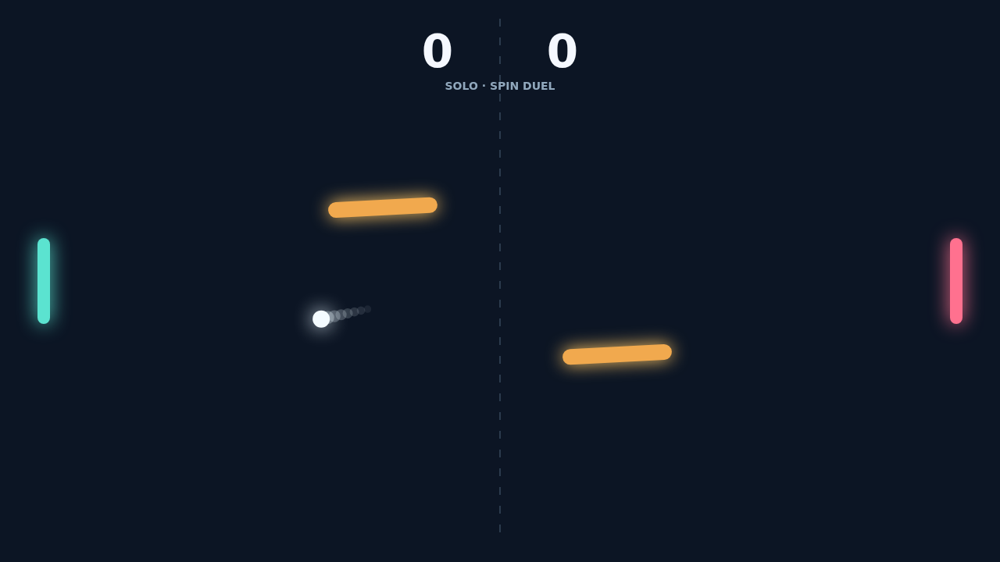

A rally in Carom is a duel of timing and angles. Send the ball across the dark field, read the moving gaps, and shape your return with the paddle.

Every moving paddle adds spin at contact. A quick downward slide bends the ball one way; an upward swipe bends it the other, and the curve keeps developing after the ball leaves your reach.

Two rotating gyres sway through the center. Their tilted faces turn clean returns into bank shots, and a ball that threads the gap can come back on a surprising line.

Each point begins with a fresh serve and a chance to change the rally. Match point arrives at eleven, but the duel keeps going until someone earns a two point lead.

